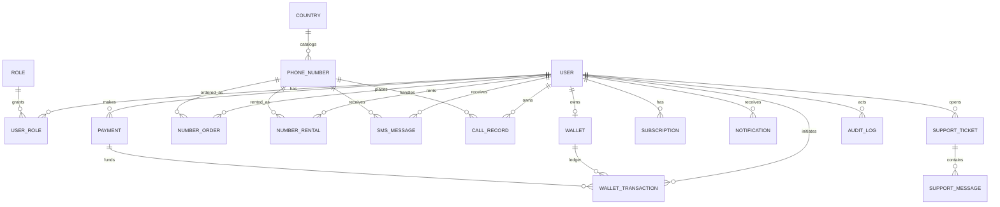

# Virtual Phone Numbers SaaS — Phase 1 System Design

**Status:** Draft for review  
**Scope:** Architecture and implementation plan only. No application code, infrastructure, credentials, or migrations are created in Phase 1.

## 1. Product scope and assumptions

The first release is a responsive web application with a versioned REST API. The backend is designed for later mobile clients to use the same API. It supports customer and administrator roles, number discovery and renting, wallet ledger operations, inbound messaging, notifications, and provider/payment adapters. Voice handling is represented only where the selected provider and local regulatory/number capabilities support it.

Critical rule: marketplace availability comes from a live provider inventory query or a clearly marked short-lived provider-backed cache. Do not manufacture inventory or promise a number until the provider has confirmed a reservation/purchase. Availability, permitted use, SMS/voice support, number portability, and rental durations vary by provider and jurisdiction. Launch countries and capabilities must be selected after provider and compliance review.

For initial implementation, use a modular monolith (one NestJS deployable with bounded modules), PostgreSQL as source of truth, Redis for ephemeral state/queues/rate limits, and a separately deployable Next.js web app. This keeps early operations manageable while preserving module and API boundaries for later extraction. Do not begin with microservices.

## 2. System architecture

```mermaid
flowchart LR
  Browser[Responsive Next.js web app] -->|HTTPS /api/v1| Edge[Nginx / TLS / request limits]
  Mobile[Future mobile clients] -. same versioned API .-> Edge
  Edge --> API[NestJS modular API]
  API --> Auth[Identity & access]
  API --> Market[Catalog & number lifecycle]
  API --> Wallet[Wallet, orders & payments]
  API --> Messaging[SMS, calls & notifications]
  API --> Admin[Admin, support & audit]
  Auth --> PG[(PostgreSQL / Prisma)]
  Market --> PG
  Wallet --> PG
  Messaging --> PG
  Admin --> PG
  API --> Redis[(Redis)]
  Worker[Queue workers / scheduled jobs] --> PG
  Worker --> Redis
  Market --> Telecom[Telecom adapter: Twilio/Telnyx]
  Messaging --> Telecom
  Telecom -->|signed webhook| Edge
  Wallet --> Pay[Payment adapter(s)]
  Pay -->|signed webhook| Edge
  API --> Email[Email provider adapter]
```

### Runtime responsibilities

- **Frontend:** public pages, customer dashboard, admin UI; calls only the API. No provider secret, payment secret, or privileged business rule lives in browser code.
- **Nginx:** TLS termination (or pass-through to managed TLS), body-size and request limits, security headers, proxying, webhook route limits. Application-level signature checks remain mandatory.
- **NestJS API:** validation, authentication/authorization, business workflows, provider orchestration, REST and WebSocket/SSE notifications.
- **Worker process:** retries, webhook event processing, email, expiration reminders, renewal attempts only when explicitly configured, reconciliation and cleanup. Queue jobs are idempotent.
- **PostgreSQL:** durable user, inventory references, orders, ledger, payment state, messages, support and audit records.
- **Redis:** short-lived cache, queue coordination, rate-limit counters, transient sessions/locks. It is not the financial ledger or authoritative number inventory.

## 3. Proposed monorepo structure

```text
virtual-phone-platform/
├── apps/
│   ├── frontend/                 # Next.js App Router, TypeScript, Tailwind, shadcn/ui
│   │   ├── app/                   # public, auth, customer, admin route groups
│   │   ├── components/            # shared UI and domain components
│   │   ├── features/              # marketplace, inbox, wallet, profile, admin
│   │   ├── lib/                   # API client, auth helpers, query client
│   │   └── tests/
│   └── backend/                  # NestJS REST API and workers
│       ├── src/
│       │   ├── common/            # guards, filters, pipes, interceptors
│       │   ├── config/
│       │   ├── prisma/
│       │   ├── auth/ users/ roles/
│       │   ├── countries/ numbers/ orders/ rentals/
│       │   ├── sms/ calls/ webhooks/ notifications/
│       │   ├── wallet/ payments/ subscriptions/
│       │   ├── support/ admin/ audit/
│       │   ├── providers/         # telecom, payment, email interfaces/adapters
│       │   └── main.ts
│       └── test/
├── packages/
│   └── shared/                    # API DTO/schema/types safe to share with browser
├── infrastructure/
│   ├── docker/                    # Dockerfiles and local service configuration
│   └── nginx/                     # reverse proxy configuration
├── prisma/                        # schema and migrations (or under backend/src/prisma)
├── docs/                          # architecture, runbooks, provider and API docs
├── docker-compose.yml             # local dev services; production overrides later
├── .env.example                   # names/placeholders only, never secrets
├── .gitignore
└── README.md
```

Keep database migrations owned by the backend. Shared package contains validation contracts and enums, not database entities or provider secrets. Route groups in the frontend should enforce presentation access only; the API is the authorization boundary.

## 4. Database design

IDs should be UUIDs (or cuid2 with a consistent policy); timestamps are UTC `timestamptz`. Money is integer minor units plus ISO currency (never floating point). Use explicit status enums and soft-delete only where business/legal retention requires it. Encrypt sensitive message content at rest where feasible, limit access, and define retention by country and customer terms before launch.



### Tables and key constraints

| Entity | Important fields and constraints |
|---|---|
| `User` | `id`, normalized unique email, password hash, verification timestamp, status, locale, created/updated timestamps. Never store plaintext password. |
| `Role`, `UserRole` | Unique role name; composite unique `(userId, roleId)`. Keep role assignment auditable. Optional permission table can be added if role matrix grows. |
| `Country` | ISO 3166-1 alpha-2 unique code, display name, calling code, enabled flag, policy metadata. Do not imply the country is served without provider-backed capability data. |
| `PhoneNumber` | Provider and provider number ID unique together; E.164 value; country FK; capabilities; provider status; last inventory check. Only persist normalized provider inventory and lifecycle facts. Avoid treating cached inventory as bookable authority. |
| `NumberOrder` | User, number/provider reference, quote snapshot, currency/minor amount, idempotency key unique per user, status, provider operation reference. Immutable price/terms snapshot. |
| `NumberRental` | User, number, order, start/expiry, renewal state, released timestamp. Constraints prevent two active claims for the same provider number where local inventory model permits. |
| `SMSMessage` | Provider message ID unique per provider; number/user relation; sender, received time, read time, content or encrypted content pointer, processing status. Index `(userId, receivedAt desc)` and `(numberId, receivedAt desc)`. |
| `CallRecord` | Provider call ID unique per provider; number/user, direction, status, start/end, duration, provider metadata. Do not record call audio unless separately designed and legally reviewed. |
| `Wallet` | One per user/currency unique `(userId, currency)`. Balance may be a cached projection of the ledger, reconciled transactionally. |
| `WalletTransaction` | Append-only ledger entry, wallet, kind, signed minor amount, currency, state, unique idempotency key, external reference, metadata. Corrections use compensating entries; never edit posted entries. |
| `Payment` | Gateway and gateway payment ID unique together; user, amount/currency, status, idempotency key, verified timestamp, webhook reference. Client return URLs never mark paid. |
| `Subscription` | User, type/plan, status, period boundaries, cancellation timestamps, gateway reference where relevant. Number rentals can be individually renewed without a SaaS plan subscription. |
| `Notification` | User, type, payload, read/delivered timestamps, dedupe key unique where applicable. Keep sensitive SMS text out of push/email notification payloads by default. |
| `SupportTicket`, `SupportMessage` | Ticket owner, status, priority, subject; messages with sender and timestamps. Restrict admin/customer visibility. Retention policy required. |
| `AuditLog` | Actor, action, target type/id, request/correlation ID, timestamp, minimized before/after metadata. Append-only; redact secrets and message bodies. |

Also add an `WebhookEvent` inbox table even though it is not in the initial requested entity list: provider, provider event ID unique, received time, signature verification result, payload reference/minimized payload, processing state, attempts and last error. This enables durable deduplication and safe retry. Add `IdempotencyRecord` (or equivalent scoped unique keys) for customer write requests.

### Relationship notes

- A user may have multiple roles but customer/admin actions are separately authorized. Admin accounts should use stronger authentication and preferably MFA.
- A provider number can exist in inventory without an owner; ownership is represented by an order/rental lifecycle, not by exposing arbitrary provider records.
- An incoming SMS is linked to a provider number and, when assigned, its current customer/rental. Resolve ownership using event time and rental interval to handle delayed webhooks.
- Wallet transaction rows are the financial source of truth. Payments are external funding events; number orders and rentals are separately tracked business operations.
- Store provider references and the minimal necessary provider data. Avoid copying entire provider payloads indefinitely.

## 5. API plan (REST `/api/v1`)

All endpoints use JSON, TLS, DTO validation, consistent error envelope, pagination, request/correlation IDs and documented idempotency requirements. Cursor pagination for event/history lists. Public catalog endpoints are rate limited. Exact request/response schemas will be generated alongside Phase 2 implementation.

| Area | Endpoint(s) | Access / behavior |
|---|---|---|
| Health | `GET /health/live`, `GET /health/ready` | Liveness; readiness checks required dependencies without leaking details. Internal or restricted in production. |
| Auth | `POST /auth/register`, `/auth/login`, `/auth/refresh`, `/auth/logout`, `/auth/verify-email`, `/auth/forgot-password`, `/auth/reset-password` | Public except refresh/logout; rate limited, generic recovery response, single-use verification/reset tokens. |
| Profile | `GET/PATCH /me`, `POST /me/change-password`, `GET /me/sessions`, `DELETE /me/sessions/:id` | Authenticated; sensitive changes require recent authentication. |
| Catalog | `GET /countries`, `GET /numbers/availability?country=&capability=&duration=` | Public or authenticated per abuse controls. Provider-backed availability with freshness metadata; no fabricated listings. |
| Orders/rentals | `POST /orders/quote`, `POST /orders`, `GET /orders`, `GET /rentals`, `GET /rentals/:id`, `POST /rentals/:id/renew`, `POST /rentals/:id/release` | Authenticated, ownership checks, idempotency key for create/renew/release. Quote is not a reservation unless explicitly held by provider. |
| SMS/calls | `GET /sms`, `GET /sms/:id`, `POST /sms/:id/read`, `GET /calls` | Authenticated, tenant scoping on every query; filters and cursor pagination. |
| Wallet/payment | `GET /wallet`, `GET /wallet/transactions`, `POST /payments/checkout`, `GET /payments`, `GET /payments/:id` | Authenticated; gateway checkout result is pending until verified server-side. No arbitrary wallet credit API. |
| Notifications | `GET /notifications`, `POST /notifications/:id/read`, `POST /notifications/read-all`, `GET /notifications/stream` | Authenticated; WebSocket or SSE stream must validate token and user scope. |
| Support | `POST /support/tickets`, `GET /support/tickets`, `GET /support/tickets/:id`, `POST /support/tickets/:id/messages` | Authenticated and ticket-owner scoped. |
| Provider webhooks | `POST /webhooks/telecom/:provider`, `POST /webhooks/payments/:provider` | Provider signature/auth verification, bounded body, durable inbox, quick acknowledgement only after persistence. No browser JWT. |
| Admin | `/admin/users`, `/admin/countries`, `/admin/numbers`, `/admin/orders`, `/admin/payments`, `/admin/wallet/adjustments`, `/admin/support`, `/admin/reports`, `/admin/audit-logs`, `/admin/config` | Explicit admin permission, MFA/re-auth for sensitive actions, immutable audit event, pagination and export limits. Never expose secrets through config API. |

Webhook handlers should verify raw request bytes before JSON mutation where required by provider, persist a unique event, and return provider-appropriate acknowledgement. A worker performs business processing and retries transient failures. Invalid signature receives rejection and security logging without storing sensitive payloads.

## 6. Authentication and session architecture

- Hash passwords with Argon2id using a maintained library and calibrated parameters. Enforce breached/common password checks where feasible; never log passwords or tokens.
- Short-lived access JWT (e.g. 5–10 minutes) signed with asymmetric key material held in server secret storage. Validate issuer, audience, expiry, algorithm and key ID. Rotate signing keys with overlap.
- Rotating opaque refresh tokens, stored hashed server-side with family/session ID, expiry, device metadata and reuse detection. On reuse, revoke the token family and require login. Revoke on logout/password reset/security event.
- For browser sessions, keep access credentials in memory where practical and refresh token in `HttpOnly`, `Secure`, `SameSite` cookie; add CSRF protection for cookie-authenticated mutations and validate `Origin`. Avoid localStorage for long-lived bearer credentials.
- Email verification and password reset use cryptographically random, hashed, single-use, short-expiry tokens. Responses do not reveal whether an email exists. Email provider credentials remain backend-only.
- RBAC guards are applied at controller and service boundaries; object-level ownership checks are required in addition to role checks. Admin operations require explicit permissions and audit records. MFA is a release requirement for production administrator access.
- Rate limit login, registration, recovery, OTP-related provider operations, catalog searches and payment creation by IP/account/device signals. Use Redis-backed limits with safe degradation.

## 7. Telecom provider strategy

Define internal interfaces such as `TelecomInventoryProvider`, `TelecomNumberProvider`, `TelecomMessagingProvider` and `TelecomVoiceProvider`. Implement a mock adapter for development and provider adapters (Twilio or Telnyx) behind feature/country capability flags. Provider-specific SDK models must not leak into domain or API contracts.

1. Country/capability catalog is reconciled from provider APIs and manual compliance enablement. Show only numbers returned as currently purchasable/assignable, with an explicit refresh timestamp and capability details.
2. Purchase uses a quote, then a provider reservation/purchase call, then persists order/rental state with an idempotent workflow. Handle timeout ambiguity by querying provider operation status before retrying; compensate/release when DB finalization fails. Never charge/confirm a customer until provider outcome is known and wallet/payment transaction is atomically recorded.
3. Incoming SMS/voice callbacks use HTTPS, provider signature validation against raw body and configured public URL, timestamp/replay protections when supported, unique event IDs, durable webhook inbox, and asynchronous processing. Deduplicate on provider event ID; SMS provider message ID is also unique.
4. Provider credentials, webhook secrets, and signing material are stored in a secret manager or deployment environment, never source control or frontend. Rotate and scope credentials; sandbox credentials in development.
5. Persist minimal provider IDs/status and normalize errors. Reconcile local active rentals against provider inventory, and alert on drift, failed callbacks, low balance, or provider outage. Do not silently claim voice is supported when number capabilities say otherwise.
6. Before production, confirm provider commercial approval, supported destination countries, acceptable-use restrictions, identity/business verification, local number registration, emergency-calling limitations, sender/number rules, message retention and data residency obligations.

## 8. Payment integration strategy

Create a `PaymentGateway` adapter with methods for creating hosted checkout/payment intents, verifying and parsing webhooks, retrieving payment state, and issuing refunds. Keep gateway IDs in `Payment`; never accept a client-supplied “paid” result as authority. A mock gateway is development-only and visibly labeled.

Use hosted checkout where possible to reduce card-data scope. Persist payment as `pending`, verify gateway-signed webhook or server-side retrieval, then in one database transaction mark the payment verified and append a wallet ledger credit using a unique idempotency key. For a number purchase, reserve/confirm provider inventory and debit through a ledger transaction with unique order linkage; failures use explicit compensation/refund entries. Support reconciliation for missing/duplicate/out-of-order webhooks. Never store raw card number/CVV. Refunds and admin wallet adjustments require permission, reason, idempotency, and audit record. Currency and rounding are explicit per transaction.

Provider selection is a launch decision: availability, supported merchant country, settlement currency, chargeback behavior, fees, webhook quality and regulatory restrictions need validation against the operator’s legal entity and target customers.

## 9. Security, privacy and resilience architecture

- **Transport and secrets:** TLS everywhere; HSTS in production; secrets injected via secret manager/environment at deploy time. `.env.example` contains placeholders only. No secrets in Git, logs, images, client bundles, analytics or error traces.
- **Application:** strict DTO schemas, output encoding, parameterized ORM access, CSP and security headers, CORS allowlist, CSRF defenses, SSRF-safe outbound integration policy, request size limits, dependency updates and secure error responses.
- **Authorization:** least privilege, tenant scoping in all queries, deny-by-default admin guards, MFA, re-auth for high-risk actions, immutable audit trail. Review IDOR, privilege escalation and mass assignment risks.
- **Webhooks:** signature validation over raw bytes, secret rotation, replay/deduplication, payload limits, event inbox, asynchronous processing, retry/backoff and dead-letter alerting.
- **Financial correctness:** integer minor units, append-only ledger, DB transactions and unique idempotency constraints, reconciliation jobs, separation of payment verification from browser redirects.
- **Data protection:** minimize stored PII and provider payloads, access controls, encryption in transit and at rest, backup encryption, deletion/export process, retention schedule and audit of privileged reads. SMS can contain authentication codes and other highly sensitive content; hide previews by default and determine retention/legal grounds before launch.
- **Operations:** structured redacted logs, metrics/traces with correlation IDs, alerting for error rate, webhook backlog, payment/provider drift and failed renewals; encrypted automated backups and tested restore runbook. Define RPO/RTO before production.
- **Abuse/compliance:** provider acceptable-use enforcement and country-specific number/SMS requirements; fraud controls, spending limits, account verification strategy, abuse reporting and lawful request process. Obtain qualified legal review for launch regions.

## 10. Development roadmap and checklist

The project request says approval is required before starting each phase. This document completes the Phase 1 deliverable; do not begin Phase 2 until the user approves this design.

| Phase | Deliverable | Exit criteria |
|---|---|---|
| 1. Planning | This architecture, ERD, API plan, security and roadmap | User reviews/approves; choose target launch country, operator entity, telecom/payment providers and retention requirements. |
| 2. Setup | Monorepo, frontend/backend scaffold, Docker Compose for PostgreSQL/Redis, Prisma, lint/format and env validation | Local services start; migrations apply; health endpoints work; no secrets committed. |
| 3. Authentication | Registration/login, verification, recovery, rotating refresh, RBAC, audit baseline | Auth flows and authorization tests pass; admin MFA planned/enforced before production. |
| 4. Public website | Responsive public pages, pricing/catalog content, auth screens | Accessible layouts, SEO metadata, responsive verification and clear non-live claims. |
| 5. Customer shell | Dashboard navigation, profile, settings, notifications and empty/loading/error states | API-connected, tenant-safe screens. |
| 6. Marketplace | Provider catalog adapter, availability, quote/order/rental/release/renewal | Mock tests and provider sandbox behavior; idempotency and recovery paths verified. |
| 7. Messaging/voice | Webhook inbox, SMS inbox, realtime updates, call history where supported | Signature, deduplication, retry, access control and retention implemented. |
| 8. Payments | Gateway adapter, hosted checkout, verified webhooks, ledger, receipts/refunds | Duplicate/out-of-order webhook and reconciliation scenarios verified. |
| 9. Admin | Users, inventory, financial ops, reports, support, audit | Permission matrix, MFA, audit coverage, export limits and sensitive action checks. |
| 10. Release | Security review, performance/accessibility, CI/CD, production Docker/Nginx, backup/restore and runbooks | Staging sign-off, provider/payment production approval, monitoring and rollback plan. |

### Decisions needed before Phase 2/production

1. Initial operating country and first customer markets.
2. Telecom provider (Twilio/Telnyx/other) and account approval status.
3. Payment gateway compatible with the operating legal entity and settlement country.
4. Base currency, pricing/tax model, refund policy, rental and renewal rules.
5. SMS content retention duration, permitted use policy, identity verification and deletion requirements.
6. Email provider and production hosting/secret-management choice.

These decisions do not prevent starting a provider-neutral Phase 2 scaffold after approval; production integrations and market promises depend on them.

## 11. Private values you will supply later

Do not send secrets in chat or commit them. In Phase 2 I will create a `.env.example` with variable names and safe placeholders, and tell you where to put your private `.env` (ignored by Git). Likely values include database and Redis credentials; JWT signing keys; telecom account ID/token and webhook signing secret; payment secret/API and webhook secret; email provider API key; public app/API URLs; and production TLS/secret-manager values. Use sandbox/test credentials during development. Real credentials are not needed for Phase 1 review.

## 12. Phase 1 checklist

- [x] System architecture and service boundaries
- [x] Architecture diagram
- [x] Monorepo folder structure
- [x] Database ER diagram and relationship notes
- [x] API endpoint plan
- [x] Authentication/session design
- [x] Telecom and payment integration strategies
- [x] Security and privacy architecture
- [x] Development roadmap and decision list
- [ ] User review and approval before Phase 2
